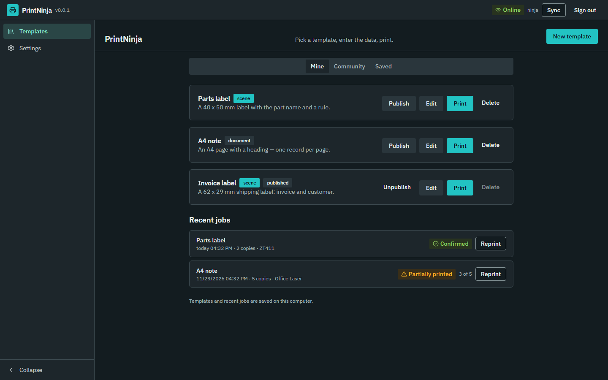
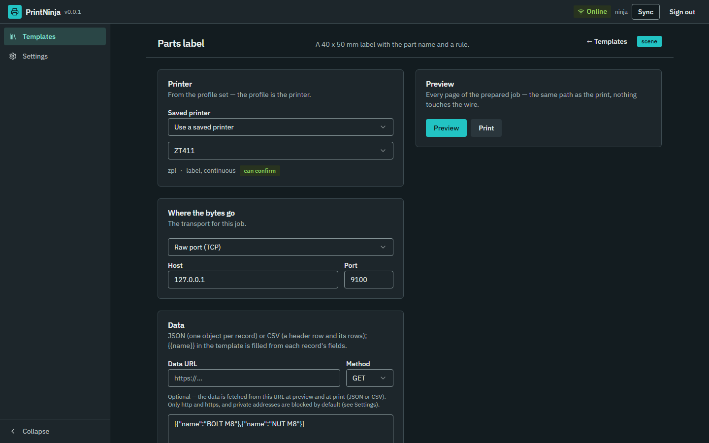
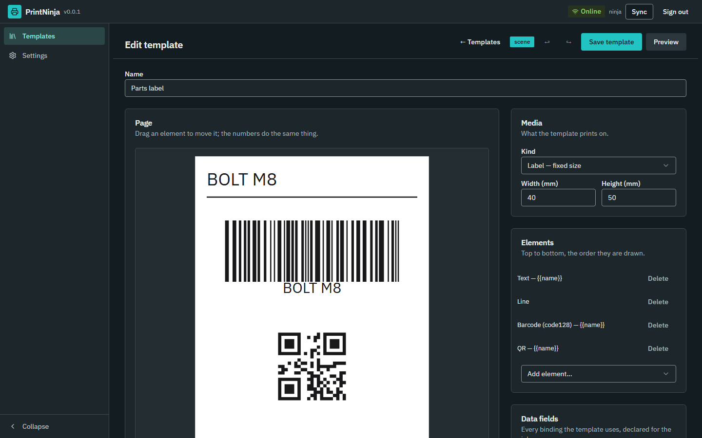
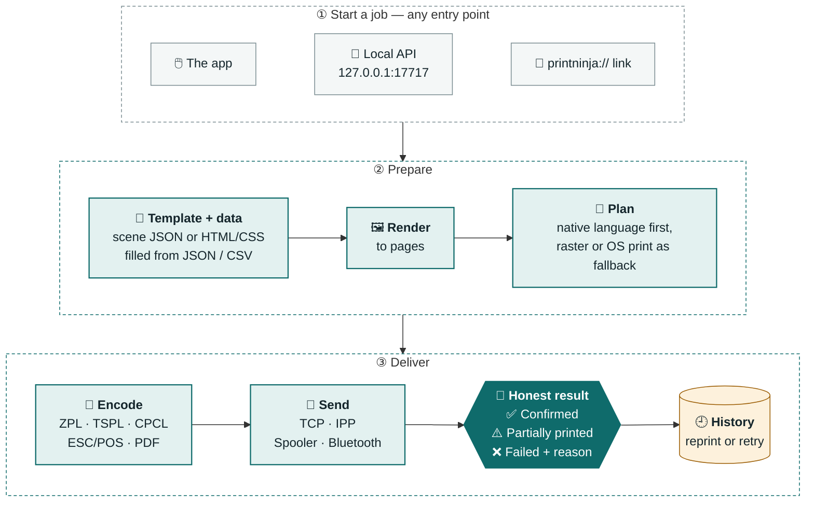

<div align="center">


# PrintNinja

**🖨️ Print receipts, labels and documents with one click. No print dialogs, no driver headaches.**

A local-first desktop app that turns templates into printer jobs for thermal, receipt, label and page printers — with a community registry for sharing templates.


[Quick start](#-quick-start) ·
[What you get](#-what-you-get) ·
[How a print works](#-how-a-print-works) ·
[Documentation](#-documentation) ·
[Contributing](#-contributing)

</div>

---

> 🖨️ Windows and Linux work today; Android is on the roadmap. The remaining work is tracked in [`docs/ROADMAP.md`](docs/ROADMAP.md), and known gaps are listed honestly in [`docs/LIMITATIONS.md`](docs/LIMITATIONS.md).

## 🥷 What is PrintNinja?

PrintNinja prints for you, quietly. You pick a printer, pick a layout, enter the data and press **Print** — the paper comes out, and every job ends in a word you can act on: *Confirmed*, *Partially printed*, *Failed*… never a silent "probably fine". 🎉

It is built for people who print the same things again and again:

- ☕ **Shops and cafés** printing receipts and kitchen tickets
- 📦 **Delivery and warehouse teams** printing shipping and parcel labels
- 🏢 **Offices** printing invoices and delivery slips
- 🖨️ **Anyone** who wants printing on a PC to just work

## 📸 Screenshots

| 🪟 The template list | 🖨️ The print screen |
|---|---|
|  |  |

| ✏️ The scene editor | 🤖 On the phone |
|---|---|
|  |  |

A curated few, committed under [`assets/`](assets/) and refreshed from a fresh
`pnpm shots` run with `pnpm shots:assets`. The full matrix — every screen in
both languages, both themes and both viewports — is generated by
[`scripts/screenshots.mjs`](scripts/screenshots.mjs) (`pnpm shots`; the
`screenshots/` output is gitignored) and uploaded as the `screenshots`
artifact on every CI run.

## ✨ What you get

- 🎨 **Templates and a designer** — a scene format for thermal media, or full HTML/CSS for page paper.
- 🖨️ **Eleven bundled printer profiles** — Zebra, TSC, Citizen, Epson, Rongta, a generic 58 mm thermal, an office laser and more. Each is marked `untested` until verified on real hardware.
- 💬 **Honest job results** — a plain word for every job, with the reason when it fails.
- 🔌 **Real transports** — raw port (TCP), IPP, the Windows spooler and Bluetooth.
- 🕘 **Reprint history** — every job is kept, with one-tap reprint and retry.
- 📡 **Local print API and deep links** — a REST API on `127.0.0.1:17717` (local only), and `printninja://print` links that prefill the print screen.
- 🌍 **A community registry** — publish, browse and save templates with a handle and password, no email.
- 📴 **Offline-first** — printing never waits on a server; registry changes queue and sync when the connection returns.
- 🌐 **English and Japanese**, light and dark themes.
- ⬆️ **An update badge** — a pill appears in the top bar when a newer release exists and points at the release page.
- 📦 **Date-versioned releases** — `YYYY.MMDD.N` versions with CI-built MSI, deb and AppImage installers, and the registry image on GHCR.

## 🖥️ Platforms

| Platform | Package | Status |
|---|---|---|
| 🪟 Windows | `.msi` | Supported |
| 🐧 Linux | `.deb` or AppImage | Supported |
| 🤖 Android | APK / AAB | Planned — labels only |
| 🍎 macOS | — | Out of scope, permanently |

Installers are attached to each [GitHub release](https://github.com/SAR-dev/PrintNinja-Next/releases). Unsigned installers trigger OS warnings; see [`docs/SIGNING.md`](docs/SIGNING.md).

## 🚀 How a print works

One pipeline, from every entry point. Whichever way a job starts, it takes the same road and ends in an honest result.



| Step | What happens |
|---|---|
| **Template + data** | Your template (scene JSON or HTML/CSS) is filled from each record of your data. |
| **Render** | The filled template becomes pages. |
| **Plan** | The planner picks the best path for the printer: its native language first, raster or OS print as the fallback. |
| **Encode** | Pages are turned into bytes in the printer's own language. |
| **Send** | The bytes go over the transport you chose, with the profile's pacing. |
| **Result** | A plain word — *Confirmed*, *Partially printed*, *Failed* — with the reason. The job is saved for reprint. |

## 🏁 Quick start

**Just want to use it?** Download the installer from the releases page, then follow the [UI guide](docs/UI_GUIDE.md): pick a template, choose a printer, paste or load your data, press **Print**.

**Want to run it from source?** You need Node 22, pnpm and Rust 1.90.0 (pinned; rustup installs it automatically). Docker is only needed for the full Rust test suite.

```bash
git clone https://github.com/SAR-dev/PrintNinja-Next.git
cd PrintNinja-Next
git checkout develop                       # integration branch
pnpm install                               # root: Tauri CLI and release scripts
pnpm -C app/ui install && pnpm -C app/ui build   # the app embeds the UI at compile time
pnpm tauri:dev                             # UI dev server + the Tauri shell
```

No printer handy? The repo ships a virtual-printer fixture you can use as a test target — see [`docs/DEVELOPMENT.md`](docs/DEVELOPMENT.md).

## 🗂️ Repository map

| Path | What lives there |
|---|---|
| `app/` | The Tauri desktop shell and the React/TypeScript UI in `app/ui/` |
| `core/` | Platform-independent Rust crates: `scene`, `render`, `planner`, `profiles`, `encoders`, `transport`, `job`, `browser` |
| `core/profiles/profiles/` | One TOML file per bundled printer model |
| `server/` | The community registry: one Rust binary plus SQLite |
| `tests/` | Golden-byte tests, end-to-end tests and the Docker test setup |
| `docs/` | Guides (see below) |
| `scripts/` | Release, versioning and screenshot scripts |

## 📚 Documentation

| Guide | What it covers |
|---|---|
| [UI guide](docs/UI_GUIDE.md) | Using the app, screen by screen |
| [Features](docs/FEATURES.md) | Everything the app can do |
| [Troubleshooting](docs/TROUBLESHOOTING.md) | Fixes for common problems |
| [Print from phone](docs/PRINT_FROM_PHONE.md) | Printing from a phone |
| [Limitations](docs/LIMITATIONS.md) | What does not work yet, and why |
| [Glossary](docs/GLOSSARY.md) | Plain meanings for the technical words |
| [Registry](docs/REGISTRY.md) | The community registry, including self-hosting |
| [Signing](docs/SIGNING.md) | Code signing and the installer warnings |
| [Development](docs/DEVELOPMENT.md) | Dev loop, toolchain, the Docker test gate |
| [Architecture](docs/ARCHITECTURE.md) | How the pieces fit together |
| [Environment](docs/ENV.md) | Every environment variable, explained |
| [CI](docs/CI.md) | What the pipelines run and why |
| [Releasing](docs/RELEASE.md) | Versioning, tags and installers |
| [Roadmap](docs/ROADMAP.md) | The remaining work, in priority order |
| [Changelog](CHANGELOG.md) | What changed, release by release |

## 🌍 Self-hosting the registry

The community registry is one Rust binary with a SQLite database (the SQL stays portable, so a hosted backend such as Turso works for production). CI builds the image on GHCR. Try it locally:

```bash
cargo run -p pn-server -- serve          # listens on 127.0.0.1:8787
```

Full guide, including Docker and migrations: [`docs/REGISTRY.md`](docs/REGISTRY.md).

## 🤝 Contributing

Bug reports, ideas, printer test results and docs fixes are all welcome — you do not need to write code. Start with [CONTRIBUTING.md](CONTRIBUTING.md): branch model, the verification loop and the house rules.

## 📄 License

No license file is present in the repository yet, so all rights are reserved by default. If you want to use or redistribute the code, please open an issue to ask.
