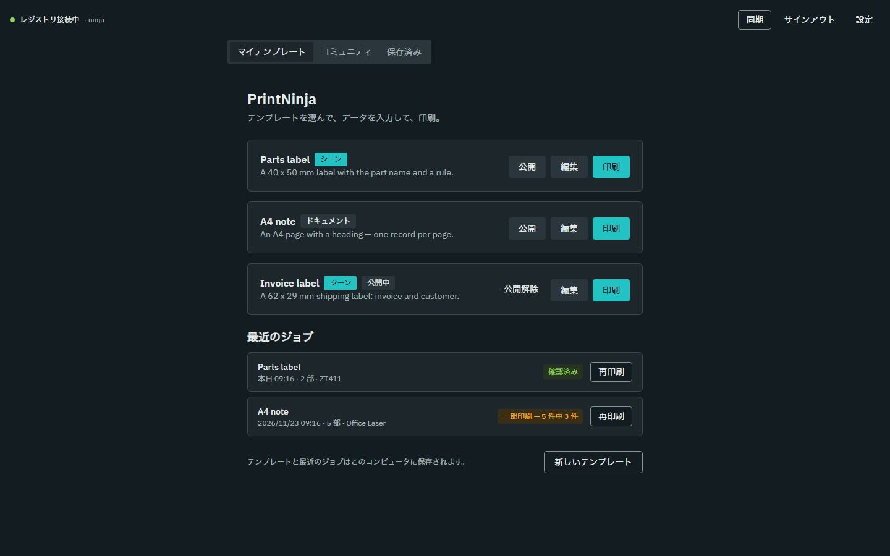
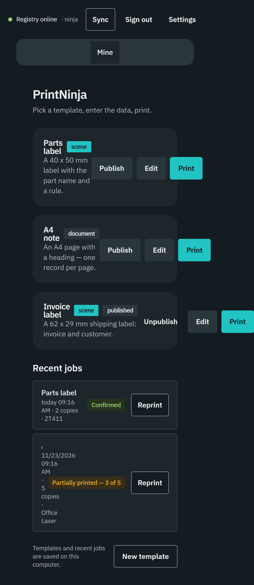

<div align="center">


# PrintNinja

**🖨️ Print receipts, labels and documents with one click. No print dialogs, no driver headaches.**

A local-first app that turns templates into printer jobs for thermal, receipt, label and page printers — with a community registry for sharing templates.

🚧 **Status: pre-release** — the greenfield rewrite of [PrintNinja](https://github.com/SAR-dev/PrintNinja), built phase by phase under [`docs/planned/REFACTORING-PLAN.md`](docs/planned/REFACTORING-PLAN.md). Windows 🪟 and Linux 🐧 for now, Android 🤖 is next.

[🚀 How a print works](#-how-a-print-works) ·
[✨ What you get](#-what-you-get) ·
[📚 Documentation](#-documentation) ·
[👩‍💻 Developers](#-developers)

</div>

---

## 🥷 What is PrintNinja?

PrintNinja prints for you, quietly, without the usual fuss. You pick a printer, pick a layout, enter the data and press **Print** — the paper comes out, and every job ends in a word you can act on: *Confirmed*, *Partially printed*, *Failed*… never a silent "probably fine". 🎉

It is built for people who print the same things again and again:

- ☕ **Shops and cafés** printing receipts and kitchen tickets
- 📦 **Delivery and warehouse teams** printing shipping and parcel labels
- 🏢 **Offices** printing invoices and delivery slips
- 🖨️ **Anyone** who wants printing on a PC to just work

## 📸 Screenshots

| 🪟 The template list | 🖨️ The print screen |
|---|---|
|  |  |

| 🇯🇵 The template list in Japanese | 🤖 On the phone |
|---|---|
|  |  |

A curated few, committed under [`assets/`](assets/). The full matrix — every screen in both languages, both themes and both viewports — is generated by [`scripts/screenshots.mjs`](scripts/screenshots.mjs) (run it locally as `pnpm shots`; its `screenshots/` output is gitignored) and is uploaded as the `screenshots` artifact on every CI run.

## ✨ What you get

- 🎨 **Templates and a designer** — a scene format for thermal media, or full HTML/CSS for page paper.
- 🖨️ **Eleven bundled printer profiles** — Zebra, TSC, Citizen, Epson, Rongta, a generic 58 mm thermal, an office laser and more (each marked `untested` until hardware-verified).
- 💬 **Honest job results** — a plain word for every job, with the reason when it fails.
- 🔌 **Real transports** — raw port (TCP), IPP, the Windows spooler and Bluetooth.
- 🕘 **Reprint history** — every job is kept, with one-tap reprint and retry.
- 📡 **Local print API + deep links** — a REST API on `127.0.0.1:17717` and `printninja://print` links prefill the print screen.
- 🌍 **A community registry** — publish, browse and save templates with a handle and password, no email.
- 📴 **Offline-first** — printing never waits on a server; registry changes queue and sync when the connection returns.
- ⬆️ **An update badge** — a top-bar pill appears when a newer release exists, pointing at the release page.
- 📦 **Date-versioned releases** — `YYYY.MMDD.N` versions with CI-built MSI, deb and AppImage installers, and the registry image on GHCR.

## 🖥️ Platforms

| Platform | Package |
|---|---|
| 🪟 Windows | `.msi` |
| 🐧 Linux | `.deb` or AppImage |
| 🤖 Android | Next (phase 11) |

macOS is out of scope, permanently. 🍎

## 🚀 How a print works

One pipeline, from every entry point: your **template** (scene JSON or HTML/CSS document) is filled with your data, **rendered** to pages, **planned** for the printer (native language first, raster or OS print as the fallback), **encoded** for that printer's language, **sent** over the transport you chose, and answered with an **honest result** — and the job lands in history, ready to reprint.

## 🏁 Getting started

- 🛠️ **Building it?** [`docs/DEVELOPMENT.md`](docs/DEVELOPMENT.md) covers the dev loop and the Docker test gate.
- 🖱️ **Using it?** [`docs/UI_GUIDE.md`](docs/UI_GUIDE.md) walks through the screens.

## 📚 Documentation

| Guide | What it covers |
|---|---|
| [Architecture](docs/ARCHITECTURE.md) | How the pieces fit together |
| [CI](docs/CI.md) | What the pipelines run and why |
| [Development](docs/DEVELOPMENT.md) | Dev loop, toolchain, the Docker test gate |
| [Environment](docs/ENV.md) | Every environment variable, explained |
| [Features](docs/FEATURES.md) | Everything the app can do |
| [Glossary](docs/GLOSSARY.md) | Plain meanings for the technical words |
| [Limitations](docs/LIMITATIONS.md) | What does not work yet, and why |
| [Print from phone](docs/PRINT_FROM_PHONE.md) | Printing from a phone |
| [Registry](docs/REGISTRY.md) | The community registry, including self-hosting |
| [Releasing](docs/RELEASE.md) | Versioning, tags and installers |
| [Signing](docs/SIGNING.md) | Code signing and the installer warnings |
| [Troubleshooting](docs/TROUBLESHOOTING.md) | Fixes for common problems |
| [UI guide](docs/UI_GUIDE.md) | Using the app, screen by screen |

## 🌍 Registry hosting

You can host the community registry yourself: one Rust binary with a SQLite database (the SQL stays portable, so a hosted backend like Turso works for the production DB), with the image built by CI on GHCR — full guide in [docs/REGISTRY.md](docs/REGISTRY.md).

## 👩‍💻 Developers

```bash
git clone https://github.com/SAR-dev/PrintNinja-Next.git
cd printninja-next
pnpm install
pnpm -C app/ui install && pnpm -C app/ui build   # the app embeds the UI at compile time
pnpm tauri:dev
```

Setup, the verification loop and the house rules are in [CONTRIBUTING.md](CONTRIBUTING.md).

## 📄 License

See the repository for license terms.
